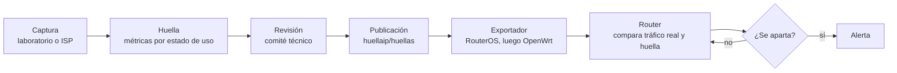

# HuellaIP

**Lo normal de cada dispositivo, compartido entre todos.**

HuellaIP construye, de forma abierta y colaborativa, la *huella* de red de cada dispositivo del hogar y de la pyme: con quién habla, cuántas sesiones abre, cuánto tráfico mueve y a qué ritmo. Con esa huella, un router MikroTik u OpenWrt puede darse cuenta de que un equipo empezó a comportarse como malware.

> [!NOTE]
> **Estado: fase 0, fundaciones.** Todavía no hay huellas publicadas ni herramientas listas para usar. Estamos armando el formato, el laboratorio y la comunidad. Si querés sumarte desde el principio, este es el momento: [cómo participar](#cómo-participar).

## In English

HuellaIP is an open, community-driven project that builds network behavior profiles (*huellas*, Spanish for "footprints") for home and small-business devices: which destinations each device talks to, how many sessions it opens, how much traffic it moves and at what pace, measured per usage state. Each profile is a valid MUD file (RFC 8520) with a quantitative extension, so MikroTik and OpenWrt routers can flag a device that starts behaving like malware.

Metadata only, never content. Defensive only. The project is based in Argentina and is at an early stage. Documentation is in Spanish; code and comments are in English. Questions and contributions in English are welcome in [Discussions](https://github.com/huellaip/huellaip/discussions).

## El problema

Un TV box genérico de unos treinta dólares, recién enchufado y sin que nadie abriera una aplicación, hizo 232.006 intentos de conexión en 38 segundos hacia 4.900 direcciones IP distintas, contra los puertos 22 y 23. Consumía entre 1 y 2 Mbps, así que ningún gráfico de ancho de banda mostraba nada. Lo delataban los paquetes por segundo. El caso está contado en [*Le vendimos conectividad. Le delegamos una red*](https://www.linkedin.com/pulse/le-vendimos-conectividad-delegamos-una-red-uriel-rozenbaum-ganbe/).

Un hogar o una pyme chica tiene hoy quince o veinte dispositivos conectados, la mitad sin pantalla, sin usuario y sin nadie que los vigile. El router ve todo ese tráfico, pero no tiene contra qué compararlo. Y cuando un equipo queda comprometido, la IP que termina en las listas negras es la del cliente y la de su proveedor.

## Por qué todavía no existe

Las piezas están, pero nadie las terminó:

- **MUD ([RFC 8520](https://www.rfc-editor.org/info/rfc8520))** permite describir con quién debería comunicarse un dispositivo. Es una lista de contactos: no dice cuánto tráfico, cuántas sesiones ni a qué ritmo.
- **La extensión de ancho de banda para MUD** ([borrador IETF de 2019](https://datatracker.ietf.org/doc/draft-lear-opsawg-mud-bw-profile/)) proponía justamente eso. Venció en 2020 sin que nadie la retomara.
- **Las dos le piden los números al fabricante.** En nuestro mercado, el fabricante muchas veces es parte del problema: la botnet [BadBox 2.0](https://www.humansecurity.com/learn/blog/satori-threat-intelligence-disruption-badbox-2-0/) reunió más de un millón de equipos, muchos con el malware instalado de fábrica.
- **Los perfiles académicos quedaron como fotos estáticas**, [SPIN](https://github.com/SIDN/spin) (SIDN Labs), que compartía perfiles entre routers, se archivó en 2025, y ningún dataset público cubre los TV boxes Android genéricos que abundan en la Argentina.

HuellaIP propone que los números los mida una comunidad: operadores, universidades y gente que configura routers todos los días.

## Cómo funciona



Todo pasa en el router o en un colector al lado: no hay que instalar nada en los dispositivos. Por defecto, los exportadores generan reglas en modo **solo alerta**, porque un sistema que bloquea lo legítimo termina ignorado.

## La huella

Cada huella es un archivo MUD válido con una extensión propia, `huellaip-perfil`. Cualquier herramienta que entienda MUD puede leer la parte de destinos permitidos; los exportadores de HuellaIP usan además la parte cuantitativa.

Las métricas se miden por **estado de uso**:

| Estado | Qué es |
|---|---|
| `encendido` | Desde que el equipo se energiza hasta que se estabiliza |
| `reposo` | Encendido, sin interacción humana |
| `activo` | Uso típico: streaming, impresión, video de una cámara |
| `interaccion` | Control desde la app del fabricante |

En cada estado, la huella registra:

- sesiones concurrentes (p50, p95 y máximo observado);
- bytes subidos y bajados por hora (p95);
- conexiones nuevas por minuto (p95);
- periodicidad de las comunicaciones de mantenimiento (keepalives);
- destinos esperados: dominios y sistemas autónomos (ASN);
- versión de TLS esperada, alineada con [RFC 9761](https://www.rfc-editor.org/info/rfc9761).

Cada huella se versiona por firmware, porque una actualización alcanza para cambiar el comportamiento. Además declara un nivel de confianza (`baja`, `media`, `alta`) y una etiqueta (`benigno`, `sospechoso`, `malicioso`).

Un fragmento, con valores ficticios:

```json
"reposo": {
  "sesiones_concurrentes": { "p50": 3, "p95": 6, "max": 9 },
  "bytes_subida_hora_p95": 2500000,
  "bytes_bajada_hora_p95": 800000,
  "conexiones_nuevas_min_p95": 2,
  "keepalive_segundos": 60,
  "destinos": ["cloud.fabricante-ejemplo.com"],
  "asn_esperados": [64500],
  "tls_version": "1.2"
}
```

La especificación completa va a vivir en `especificacion/formato-huella-v0.md`, junto con su esquema JSON y ejemplos válidos e inválidos.

## Qué no es HuellaIP

- **No mira contenido.** Trabaja con metadatos: destinos, puertos, sesiones, volúmenes, tiempos, consultas DNS y parámetros de TLS.
- **No es una herramienta de ataque.** No escribimos, mejoramos ni distribuimos malware, exploits ni herramientas ofensivas. El tráfico anómalo de prueba es sintético y va contra servidores propios.
- **No es vigilancia ni una cruzada antipiratería.** No evalúa qué contenido se consume: detecta dispositivos que hacen algo que su categoría no hace nunca.
- **No reemplaza al firewall.** Le da al firewall algo con qué comparar.

## Estado y hoja de ruta

El prototipo arranca a fines de octubre de 2026 y dura unas 12 semanas. Las fiestas y las vacaciones de enero pueden estirar las últimas fases.

| Fase | Semanas | Qué deja |
|---|---|---|
| **0. Fundaciones** | 1 a 3 | Repositorios, gobernanza, formato v0 con esquema JSON y un CI que lo valida |
| **1. Maqueta** | 2 a 4 | Laboratorio reproducible con un hEX RB750Gr3 y una Raspberry Pi 5: IPFIX, Zeek y un segmento de cuarentena con filtros probados |
| **2. Primeras huellas** | 5 a 8 | Cuatro dispositivos cableados medidos en los cuatro estados, y un TV box genérico observado 30 días en cuarentena |
| **3. Detección** | 9 a 11 | Exportador a RouterOS en modo solo alerta, probado contra anomalías sintéticas |
| **4. Publicación** | 12 | Versión 0.1.0 de la especificación y de las huellas, y una guía para replicar la maqueta |

El prototipo se limita a dispositivos cableados e IPv4. Después vienen WiFi, IPv6, el exportador a OpenWrt (nftables), un honeypot MikroTik con su plan de contención, pilotos con ISPs y exportadores para FortiGate y CPEs.

## Estructura del repositorio

```text
huellaip/
├── README.md
├── LICENSE                     Apache-2.0
├── CONTRIBUTING.md             cómo aportar
├── CODE_OF_CONDUCT.md
├── SECURITY.md                 cómo reportar un problema de seguridad
├── GOVERNANCE.md               quién decide y cómo
├── especificacion/             formato de huella, esquema JSON y ejemplos
├── docs/                       metodología de captura, privacidad y contención
├── laboratorio/                configuración de RouterOS y playbook de Ansible
├── herramientas/huellaip_lab/  orquestador, generador y validador
├── exportadores/routeros/      de la huella a reglas de RouterOS
└── .github/                    plantillas de issues y PR, integración continua
```

Las carpetas se van completando a medida que avanza el prototipo. Las huellas publicadas viven en otro repositorio, [`huellaip/huellas`](https://github.com/huellaip/huellas).

## Cómo participar

Buscamos especialmente:

- **Operadores** que presten dispositivos, compartan datos agregados y anónimos y, más adelante, ofrezcan pilotos.
- **Universidades** que aporten metodología, validación y temas de tesis.
- **Gente de RouterOS y nftables** que quiera escribir reglas y probarlas en serio.
- **Laboratorios** que repliquen la maqueta y aporten capturas con la misma metodología.
- **Quien quiera llevar la extensión a la IETF**, esta vez con datos de campo.

Para empezar:

1. Leé [CONTRIBUTING.md](CONTRIBUTING.md), sobre todo las líneas rojas.
2. Presentate o preguntá en [Discussions](https://github.com/huellaip/huellaip/discussions).
3. Buscá issues con la etiqueta [`good first issue`](https://github.com/huellaip/huellaip/labels/good%20first%20issue).
4. Para proponer o revisar huellas, andá a [`huellaip/huellas`](https://github.com/huellaip/huellas).

## Gobernanza

HuellaIP es un proyecto abierto e independiente: ningún ISP, fabricante ni empresa es dueño del proyecto. Por ahora lo conduce un comité técnico provisorio de tres personas, que se reemplaza por uno elegido por quienes aportan cuando el proyecto llegue a diez organizaciones participando. El detalle está en [GOVERNANCE.md](GOVERNANCE.md).

## Licencias

| Qué | Dónde | Licencia |
|---|---|---|
| Código, especificación, esquema, documentación y configuración del laboratorio | Este repositorio | [Apache-2.0](LICENSE) |
| Huellas publicadas | [`huellaip/huellas`](https://github.com/huellaip/huellas) | CC-BY-4.0 |
| Código de conducta, adaptado del Contributor Covenant 3.0 | [`CODE_OF_CONDUCT.md`](CODE_OF_CONDUCT.md) | CC BY-SA 4.0 |

Los aportes se hacen bajo el [Developer Certificate of Origin](https://developercertificate.org/): quien aporta conserva sus derechos y entrega su trabajo bajo la licencia del repositorio.

## Antecedentes

HuellaIP no inventa un estándar: retoma lo que otros dejaron a medio camino.

- [RFC 8520](https://www.rfc-editor.org/info/rfc8520): Manufacturer Usage Description (MUD).
- [draft-lear-opsawg-mud-bw-profile](https://datatracker.ietf.org/doc/draft-lear-opsawg-mud-bw-profile/): perfiles de ancho de banda para MUD (vencido en 2020).
- [RFC 9238](https://www.rfc-editor.org/rfc/rfc9238.html): archivos MUD desde códigos QR, con una sección sobre archivos aportados por terceros.
- [RFC 9761](https://www.rfc-editor.org/info/rfc9761): MUD para perfiles TLS y DTLS.
- [MUDgee](https://github.com/ayyoob/mudgee) y los [perfiles MUD de UNSW](https://iotanalytics.unsw.edu.au/mudprofiles.html).
- [SPIN](https://github.com/SIDN/spin), de SIDN Labs (archivado).
- [CIC IoT Dataset 2022](https://www.unb.ca/cic/datasets/iotdataset-2022.html), base de la metodología por estados de uso.

## Aliados

[Cerrando la Brecha](https://cerrandolabrecha.org/) acompaña el proyecto, con foco en voluntariado y formación en redes y ciberseguridad alrededor del laboratorio.

## Contacto

- **Preguntas, ideas y propuestas:** [Discussions](https://github.com/huellaip/huellaip/discussions).
- **Vulnerabilidades o datos sensibles subidos por error:** canal privado descripto en [SECURITY.md](SECURITY.md). No abras un issue público.
- **Otras consultas:** [huellaip@googlegroups.com](mailto:huellaip@googlegroups.com)
