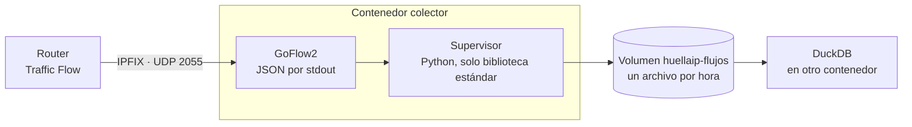

# Diseño: colector IPFIX en Docker

> **Estado:** aprobado el 13 de noviembre de 2026.
> Lo que figura como **(decisión de Uriel)** lo decidió él. Lo que figura como **(propuesta)** lo propuso Claude y quedó aprobado con el diseño.
> Forma parte del [plan del prototipo](../plan-prototipo.md).

---

## 1. Para qué

El colector recibe los flujos IPFIX que exporta el router del laboratorio y los guarda en archivos locales. Con esos archivos, el resto del circuito calcula las métricas por estado y genera las huellas usando DuckDB (sección 6 del [plan](../plan-prototipo.md)).

Se entrega como una imagen de Docker y nada más. En el host no se instala nada fuera de Docker, así cualquier integrante del proyecto lo levanta igual en su laboratorio **(decisión de Uriel, 12/11)**.

## 2. Objetivos, no objetivos y antiobjetivos

**Objetivos de la versión 0.1:**
- Recibir IPFIX por UDP 2055. GoFlow2 decodifica también NetFlow v9 y v5 en el mismo puerto.
- Guardar cada flujo como una línea JSON, en un archivo por hora, comprimido al cerrarse.
- Aplicar una retención configurable y proteger el disco.
- Registrar los campos de NAT de IPFIX además de los estándar. Hacen falta para atribuir los flujos de bajada a la IP privada de cada dispositivo (sección 4 del plan).
- Publicar la misma imagen para `linux/arm64` (la Pi 5) y `linux/amd64`, con versión fija, y que se levante con `docker compose up -d`.
- Construir la imagen en el CI desde el repo y publicarla en `ghcr.io/huellaip/colector`.

**No objetivos de la versión 0.1:**
- sFlow. GoFlow2 lo soporta, pero el laboratorio no lo usa.
- Análisis, tableros o alertas: van en otras herramientas.
- Zeek, la recepción de syslog y el orquestador. Cada uno va en su propio contenedor y en su propio PR.
- Mandar los flujos fuera del equipo, por ejemplo a Kafka o a la nube.
- Alta disponibilidad.
- Firmar la imagen con cosign. Queda para una versión siguiente.

**Antiobjetivos.** El colector fracasa aunque funcione si:
- hace falta instalar algo en el host además de Docker;
- los flujos crudos, con MAC completas e IP privadas, salen del equipo o terminan en el repo;
- se pierden flujos sin que nadie se entere;
- la imagen depende de `latest` o de algo sin versión fija.

## 3. Restricciones

| Tema | Restricción |
|---|---|
| Host | Solo Docker Engine y Compose v2 o posterior. La configuración de red del host (IP fija o reservada) no es parte del colector |
| Arquitecturas | `linux/arm64` y `linux/amd64` |
| Repo | Público, licencia Apache-2.0. Código y comentarios en inglés; documentación en castellano (decisión del 23/10) |
| Privacidad | Ley 25.326 y principios del proyecto: los datos crudos no se publican y quedan en un volumen local |
| Componente base | GoFlow2 v2.2.7 (BSD-3), con imagen oficial para amd64 y arm64 |
| Costo | Cero: GHCR es gratis para paquetes públicos y los runners arm64 son gratis en repos públicos (sección 10) |

## 4. Enfoques considerados

| Enfoque | A favor | En contra |
|---|---|---|
| **A.** Imágenes oficiales y configuración en el repo | No hay nada que compilar ni publicar; los parches llegan de upstream | GoFlow2 no rota archivos: hace falta un segundo contenedor que comparta los procesos y le mande SIGHUP. Si la reapertura falla, GoFlow2 sigue escribiendo a un archivo cerrado sin avisar (visto en `transport/file/transport.go`) |
| **B.** Imagen propia con GoFlow2 fijado y un supervisor | Un solo contenedor, con los valores por defecto del proyecto, la misma imagen en todos lados y versionada con el repo | El proyecto mantiene una imagen y su CI |
| **C.** Colector propio desde cero | — | Reinventa lo que GoFlow2 ya resuelve y mantiene |

**Elegido: B (decisión de Uriel, 12/11).**

## 5. Diseño

### 5.1 Cómo funciona



- **GoFlow2 escribe a stdout**, sin la opción `-transport.file`. El supervisor lo arranca como proceso hijo y es el único que escribe archivos. Así se evita la reapertura por SIGHUP y su falla silenciosa **(propuesta)**.
- **El supervisor:**
  - lee línea por línea y escribe en el archivo de la hora en curso, en UTC;
  - cuando cambia la hora, cierra el archivo anterior y lo comprime con gzip;
  - aplica la retención y el control de espacio (sección 5.2).
- **Si GoFlow2 se cae,** el supervisor lo registra y lo vuelve a arrancar con una espera creciente. Después de cinco caídas seguidas, el contenedor sale con error y Docker lo reinicia por `restart: unless-stopped` **(propuesta)**.
- **Escritura a disco:** el supervisor baja los datos cada 5 segundos. Ante un corte de luz se pierden como máximo esos segundos **(propuesta)**.
- **Hora:** el contenedor usa el reloj del host. La sincronización es del sistema operativo.

### 5.2 Configuración

Por variables de entorno. Los nombres van en inglés, como el código.

| Variable | Por defecto | Qué hace |
|---|---|---|
| `LISTEN_PORT` | `2055` | Puerto UDP de escucha |
| `RETENTION_DAYS` | `90` | Días que se guardan los archivos cerrados **(propuesta)** |
| `MIN_FREE_GB` | `5` | Si el espacio libre baja de este valor, se borran los archivos más viejos. Si aun así no alcanza, se deja de escribir y el contenedor queda `unhealthy` (protege al resto del host) **(propuesta)** |
| `FLUSH_SECONDS` | `5` | Cada cuánto se bajan los datos a disco |
| `GOFLOW2_EXTRA_ARGS` | vacío | Opciones adicionales para GoFlow2, para casos especiales |

**Mapeo de campos.** `mapping.yaml` viene dentro de la imagen y se puede reemplazar montando otro archivo. Agrega los campos de NAT de IPFIX:
- 225: `postNATSourceIPv4Address`;
- 226: `postNATDestinationIPv4Address`;
- 227: `postNAPTSourceTransportPort`;
- 228: `postNAPTDestinationTransportPort`.

**Por qué 90 días.** El reposo del TV box dura 30 días y después hay que procesarlo.

### 5.3 Formato de salida

- **Cada línea es el JSON de GoFlow2 sin cambios:** `type`, `time_received_ns`, `sampler_address`, `time_flow_start_ns`, `time_flow_end_ns`, `bytes`, `packets`, `src_addr`, `dst_addr`, `proto`, `src_port`, `dst_port`, `in_if`, `out_if`, `src_mac`, `dst_mac` y demás campos, más los de NAT. El esquema es el de GoFlow2 en la versión fijada. Un cambio de versión de GoFlow2 se revisa como un cambio de formato.
- **Organización de los archivos:** `/datos/flujos/AAAA/MM/DD/AAAA-MM-DDTHH.jsonl.gz`, en UTC. El archivo en curso no tiene `.gz`. DuckDB lee los dos con un mismo glob.
- **Ejemplo:** el README del colector muestra una línea de ejemplo con valores ficticios.

### 5.4 Seguridad del contenedor

- Corre con un usuario sin privilegios y un UID fijo.
- El sistema de archivos raíz es de solo lectura, con `/tmp` en memoria.
- `cap_drop: ALL` y `no-new-privileges`.
- Solo se publica el puerto 2055/udp.
- **Red bridge (propuesta).** Hay que verificar que `sampler_address` traiga la IP del router y no la del bridge de Docker. Si no la trae, se pasa a `network_mode: host` y se documenta.
- **Healthcheck:** el supervisor actualiza un archivo de latido. El chequeo verifica que el latido sea reciente y que GoFlow2 esté vivo.
- Los logs de Docker tienen tope de tamaño, porque sin configurarlo crecen sin límite.
- **Sin filtro por origen (propuesta).** El colector acepta IPFIX de cualquier IP, porque filtrar requiere reglas de firewall en el host. `sampler_address` permite descartar lo que no venga del router. En la maqueta, la red de gestión solo tiene al hEX y a la Pi.

### 5.5 Datos y privacidad

- **Dónde quedan los datos.** Por defecto, en un volumen con nombre, `huellaip-flujos`, fuera del árbol del repo. Se puede montar una ruta propia, por ejemplo el NVMe de la maqueta **(propuesta)**.
- **Qué contienen.** El volumen tiene MAC completas e IP privadas, y nunca se sube. El patrón `flujos/` del `.gitignore` sirve de red de seguridad.
- **La imagen no contiene datos.**

### 5.6 Archivos en el repo

```text
laboratorio/colector/
├── Dockerfile
├── compose.yaml        imagen ghcr.io/huellaip/colector:0.1.0, con build: . para construirla local
├── .env.example
├── mapping.yaml
├── supervisor/         código Python del supervisor
├── tests/              pruebas del supervisor y prueba de integración
└── README.md           requisitos, cómo levantarlo, cómo verificarlo, privacidad
.github/workflows/colector.yml
.github/dependabot.yml
```

### 5.7 La imagen

- **Construcción en varias etapas:**
  - el binario de GoFlow2 v2.2.7 sale de la imagen oficial fijada por digest (`/goflow2`), o se compila desde el código fuente (ver sección 8);
  - la imagen de ejecución es la oficial de Python 3 slim, en la versión estable vigente y fijada por digest.
- **Etiquetas OCI:** `org.opencontainers.image.source`, que vincula el paquete con el repo; `version`; y `licenses=Apache-2.0`.
- **Tamaño estimado:** menos de 100 MB por arquitectura (supuesto, a medir).

### 5.8 CI

**En cada PR que toque `laboratorio/colector/**`:**
- `ruff` y `pytest` del supervisor: rotación, compresión, retención y espacio mínimo. El reloj se inyecta en las pruebas, así no hace falta esperar una hora real.
- Construcción sin publicar en `ubuntu-24.04` y `ubuntu-24.04-arm`, nativa en las dos arquitecturas y sin emulación.
- **Prueba de integración:**
  - se levanta el contenedor y se le mandan mensajes IPFIX sintéticos, con plantilla y datos;
  - se verifica que aparezca una línea JSON con los campos esperados;
  - se verifica que el healthcheck dé `healthy`;
  - la rotación ya la cubren las pruebas del supervisor.

**Al crear una etiqueta `colector-v*` sobre `main`:**
- construcción nativa por arquitectura;
- un manifiesto multiarquitectura;
- publicación en GHCR con las etiquetas `0.1.0` y `0.1`;
- atestación de procedencia y SBOM.

**Además:**
- Dependabot vigila las GitHub Actions y las imágenes base.
- Permisos mínimos: `contents: read` en general, y `packages: write` solo en el job que publica.

### 5.9 Versiones

- El colector tiene su propia versión semántica, independiente de la especificación: `colector-v0.1.0`.
- El `compose.yaml` fija la versión; nunca usa `latest`.
- Hasta que exista la primera versión publicada, la imagen se construye en el equipo con `docker compose up -d --build`. Es Docker igual: no se instala nada en el host.
- Las etiquetas de versión las crea el mantenedor después de integrar el PR.

### 5.10 Verificación del primer despliegue

1. `docker compose up -d` en el equipo colector, y el router apuntando a su IP.
2. En `docker compose logs`, que GoFlow2 haya arrancado y que el supervisor esté escribiendo.
3. Que la primera línea JSON traiga `sampler_address` con la IP del router.
4. Que pasada una hora aparezca el primer `.gz`.
5. La prueba de medición del plan (prueba de humo 1): los bytes de IPFIX contra un volumen conocido.

## 6. Cambios al plan que salen de este diseño

Van en el plan v0.2:
- **Todo lo que corre en la Pi va en contenedores (propuesta).** El playbook de Ansible sale del plan. Los requisitos del host quedan en Docker y la configuración de red.
- **Zeek** usa la imagen oficial `zeek/zeek` (amd64 y arm64), en su propio contenedor, con `network_mode: host` y la interfaz de captura.
- **La recepción de syslog** va en su propio contenedor.
- **DuckDB y el orquestador** van en una imagen de herramientas, más adelante.
- **NTP (propuesta).** El hEX y la Pi se sincronizan contra el mismo pool público y la Pi deja de ser servidor NTP. Servirlo desde un contenedor agrega una pieza sin necesidad. La prueba de humo de la hora (menos de 1 s de diferencia) se mantiene.

## 7. Entrega

| Paso | Qué | Quién |
|---|---|---|
| PR 1 | Documentos: este diseño y el plan v0.2 en `docs/plan-prototipo.md` | Claude prepara; Uriel revisa e integra |
| PR 2 | Colector: imagen, compose, pruebas, CI y README | Claude prepara; Uriel revisa e integra |
| Publicación | Crear la etiqueta `colector-v0.1.0`. La primera vez, hacer pública la imagen en GHCR desde la organización | Uriel |
| Despliegue | Primer despliegue en un equipo propio, documentado aparte | Uriel con Claude |

## 8. Lo que queda a criterio de quien lo construya

- Copiar el binario de la imagen oficial o compilarlo desde la fuente. Hay que verificar que quede un binario estático que corra sobre la imagen de Python.
- La sintaxis exacta del mapeo de NAT en GoFlow2 v2.2.7, y si los campos agregados salen en el JSON. Si no salen, se documenta la limitación y se lleva a la sección 4 del plan.
- **La MAC de destino.** GoFlow2 llena `dst_mac` con el campo 57, `postDestinationMacAddress`. Un exportador puede mandarla en el 80, `destinationMacAddress`. Hay que ver cuál usa RouterOS y, si es el 80, agregarlo al mapeo.
- Si GoFlow2 expone las plantillas recibidas por HTTP, usarlo como diagnóstico dentro del contenedor (`docker compose exec`). Sirve para ver qué campos manda RouterOS, incluidos los de NAT.
- La estructura del código del supervisor y el formato de sus logs.

## 9. Decisiones propuestas por Claude (aprobadas el 13/11)

1. Aplicar la regla de solo Docker a todo lo que corre en la Pi, no solo al colector.
2. Que GoFlow2 escriba a stdout y el supervisor sea el dueño de los archivos.
3. Archivos por hora, en UTC, con JSON de GoFlow2 sin transformar.
4. Retención por defecto de 90 días y piso de 5 GB libres.
5. Volumen con nombre por defecto, fuera del repo.
6. Red bridge con verificación de `sampler_address`, y sin filtro por origen.
7. Sacar la Pi como servidor NTP.
8. Versión propia del colector (`colector-v*`) y dos PRs: primero los documentos, después el código.
9. **Versión pública del plan.** El plan se publica sin los datos internos de coordinación. Suma las decisiones tomadas desde la v0.1 y corrige `version=ipfix`.

## 10. Fuentes

- [GitHub Packages: facturación](https://docs.github.com/en/billing/concepts/product-billing/github-packages): gratis para paquetes públicos. El almacenamiento y la transferencia del Container registry son gratis por ahora, con un mes de aviso antes de cualquier cambio. Para paquetes privados en el plan gratuito de organizaciones, 500 MB y 1 GB de transferencia por mes.
- [Container registry](https://docs.github.com/en/packages/working-with-a-github-packages-registry/working-with-the-container-registry): 10 GB por capa y 10 minutos por subida. La primera publicación queda privada.
- [Runners arm64 en repos públicos](https://github.blog/changelog/2025-08-07-arm64-hosted-runners-for-public-repositories-are-now-generally-available/): gratis, con la etiqueta `ubuntu-24.04-arm`.
- [GoFlow2](https://github.com/netsampler/goflow2): v2.2.7 del 30/09/2026, BSD-3. Imagen `netsampler/goflow2` para amd64 y arm64. La reapertura por SIGHUP está en `transport/file/transport.go`. El mapeo de campos IPFIX está en `docs/protocols.md`.
- [Zeek en Docker Hub](https://hub.docker.com/r/zeek/zeek/tags): 9.0.1 y `lts` 8.0.11, para amd64 y arm64.
- [IANA: IPFIX Information Elements](https://www.iana.org/assignments/ipfix/ipfix.xhtml): campos 225 a 228 de NAT; 56 y 81 de MAC de origen; 80 y 57 de MAC de destino.
