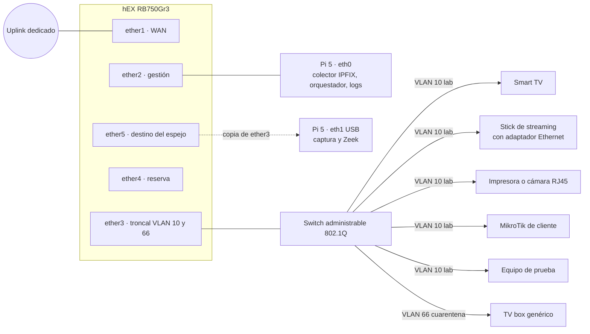
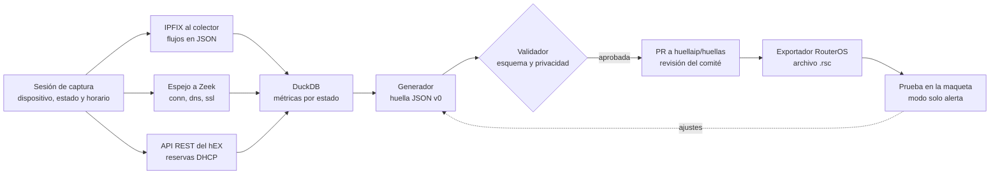
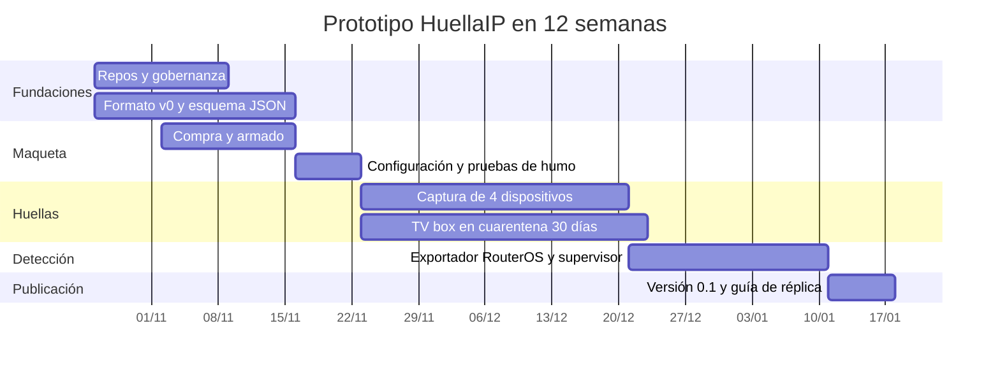

# HuellaIP: plan de implementación del prototipo

> Versión 0.2 · 13 de noviembre de 2026. Es la primera versión pública; reemplaza a la v0.1 del 23 de octubre.
>
> Los comandos de este plan son un borrador. Hay que validarlos en la maqueta antes de darlos por buenos.

**En 12 semanas, el prototipo deja cuatro cosas:**
- dos repos públicos con el formato de huella v0;
- una maqueta reproducible (hEX y Raspberry Pi 5);
- las primeras cuatro huellas de dispositivos cableados, más el seguimiento en cuarentena de un TV box genérico;
- un exportador a RouterOS probado contra anomalías sintéticas.

WiFi, IPv6, OpenWrt, honeypot y pilotos con ISPs quedan para después del prototipo.

**Cambios respecto de la v0.1:**
- Todo el software de la Pi corre en contenedores de Docker. En el host solo se instala Docker, y el playbook de Ansible sale del plan (secciones 1 y 5).
- El colector IPFIX es una imagen propia del proyecto, `ghcr.io/huellaip/colector`. El diseño está en [`disenos/2026-11-12-colector-ipfix.md`](disenos/2026-11-12-colector-ipfix.md).
- La Pi deja de ser servidor NTP: el hEX y la Pi se sincronizan contra el mismo pool público (secciones 4 y 5).
- Corrección: el valor de Traffic Flow es `version=ipfix` (sección 4).
- Zeek ya publica su imagen oficial para arm64, así que la validación temprana pasa a medir el rendimiento (sección 5).
- Se registran las decisiones tomadas desde la v0.1 (sección 13) y se actualiza el estado del checklist (sección 14).

---

## 1. Decisiones tomadas

| Tema | Decisión | Motivo |
|---|---|---|
| Router de la maqueta | hEX RB750Gr3, dedicado a la maqueta | 256 MB de RAM, cinco puertos gigabit y espejado de puertos en el switch MT7621; corre RouterOS v7 sin apretarse |
| Controlador y supervisor | Raspberry Pi 5 | Colector IPFIX, captura de metadatos, orquestación de sesiones y detección de referencia |
| Software de la Pi | Contenedores de Docker. En el host, solo Docker y la configuración de red | Que cualquier laboratorio levante lo mismo con `docker compose` |
| Colector IPFIX | Imagen propia `ghcr.io/huellaip/colector`: GoFlow2 más un supervisor que escribe un archivo por hora | Un solo artefacto, versionado con el repo e igual en todos los laboratorios |
| Hora | El hEX y la Pi se sincronizan contra el mismo pool NTP público | Una pieza menos; la prueba de humo de la hora lo controla |
| Conectividad de los dispositivos | Solo cableada en v0 | El WiFi queda para una etapa posterior |
| Protocolo IP | Solo IPv4 en v0 (propuesta) | Menos variables en la primera medición; IPv6 entra en la etapa siguiente |
| Flujos | IPFIX desde Traffic Flow del hEX | Volúmenes, sesiones e inicios de conexión vistos por el router |
| Metadatos de paquetes | Espejo de puerto hacia la Pi y Zeek | IPFIX no trae nombres DNS, SNI ni versión de TLS |
| Repos | `huellaip/huellaip` (Apache-2.0) y `huellaip/huellas` (CC-BY-4.0) | El código y los datos van con licencias distintas; pueden sumarse más repos después |
| Aliados | Cerrando la Brecha | — |

---

## 2. Arquitectura de la maqueta

### 2.1 Topología



La Pi ve el laboratorio desde dos lugares:
- desde el router, por IPFIX: volúmenes, sesiones e inicios de conexión;
- desde el cable, por el espejo de ether3: DNS, SNI, versión de TLS y tiempos exactos.

### 2.2 Tres restricciones que definen el diseño

1. **Traffic Flow solo ve el tráfico que procesa la CPU del router.** Lo que conmuta el switch por hardware no aparece. Por eso los segmentos van ruteados, como VLAN sobre ether3 sin bridge, y sin regla de FastTrack.
2. **El espejo del switch toma un puerto origen.** Por eso el laboratorio y la cuarentena viajan como dos VLAN por el mismo cable (ether3) hacia un switch administrable. Espejando ether3 se capturan los dos segmentos a la vez, y Zeek separa por etiqueta de VLAN.
3. **El hEX no tiene WiFi.** El set v0 son solo equipos con puerto Ethernet. El punto de acceso WiFi entra en la etapa siguiente por ether4, en su propia VLAN.

**Limitación conocida:** el tráfico entre dos dispositivos de la VLAN 10 se conmuta en el switch externo y no pasa por el router, así que no queda registrado. Sí se ve todo lo que sale a internet y todo lo que cruza de una VLAN a otra. En la etapa siguiente se puede activar el aislamiento de puertos en el switch.

### 2.3 Plan de direcciones

| Segmento | Interfaz del hEX | Red | Router | Uso |
|---|---|---|---|---|
| WAN | ether1 | La del uplink | DHCP o fija | Salida a internet con IP propia del laboratorio |
| Gestión | ether2 | 10.77.0.0/29 | 10.77.0.1 | Pi 5 en 10.77.0.2 |
| Laboratorio | `vlan10-lab` sobre ether3 | 10.77.10.0/24 | 10.77.10.1 | Dispositivos v0 y equipo de prueba |
| Cuarentena | `vlan66-cuarentena` sobre ether3 | 10.77.66.0/24 | 10.77.66.1 | TV box genérico y cualquier equipo dudoso |
| Espejo | ether5 | Sin IP | — | Copia de ether3 hacia la eth1 de la Pi |
| Reserva | ether4 | — | — | Etapa WiFi o un segmento de pruebas |

Cada dispositivo tiene una reserva DHCP fija. La MAC real vive solo en el hEX y en el inventario local de la Pi, nunca en el repo.

---

## 3. Lista de materiales

| Ítem | Cant. | Estado | Notas |
|---|---|---|---|
| hEX RB750Gr3 | 1 | Disponible | Dedicado a la maqueta |
| Raspberry Pi 5 de 8 GB | 1 | A conseguir | 8 GB dan margen para Zeek y DuckDB al mismo tiempo |
| Fuente oficial USB-C de 27 W (5 V, 5 A) | 1 | A conseguir | La que recomienda Raspberry Pi |
| Active Cooler para Pi 5 | 1 | A conseguir | Zeek corre todo el día |
| M.2 HAT+ y SSD NVMe de 256 a 512 GB | 1 | A conseguir | Flujos y capturas; evita el desgaste de la tarjeta SD |
| Gabinete compatible con el HAT | 1 | A conseguir | — |
| Adaptador USB 3.0 a Gigabit Ethernet | 1 | A conseguir | Para la eth1 de captura; elegir un chipset con buen soporte en Linux |
| Switch gigabit administrable con 802.1Q, de 5 a 8 puertos | 1 | A conseguir | Troncal hacia ether3 y puertos de acceso por VLAN |
| Patch cords cat. 6 | 8 a 10 | A conseguir | — |
| Zapatilla con interruptor por toma | 1 | A conseguir | Ciclos de encendido manuales en v0 |
| Uplink dedicado con IP propia | 1 | A coordinar | Avisar al equipo de abuse del proveedor antes de conectar la cuarentena |
| UPS chica | 1 | Opcional | Evita cortes en los reposos largos |

**Dispositivos del set v0 (todos con Ethernet):**
- Smart TV Samsung o LG.
- Stick de streaming con adaptador Ethernet (Chromecast con Google TV o Fire TV).
- Impresora con puerto de red, o cámara IP con RJ45.
- Router MikroTik de cliente, perfilado como dispositivo.
- TV box Android genérico con RJ45, siempre en cuarentena.

**Postergados a la etapa WiFi:** Alexa o Echo, enchufe inteligente, robot aspiradora y cámaras Tuya.

**Cuentas:** cada dispositivo se configura con cuentas de laboratorio (Google, Amazon, apps de cámaras), nunca personales.

---

## 4. Configuración del hEX (borrador)

Se parte de una configuración vacía y se aplica por bloques, conectado por ether2.

```routeros
# HuellaIP · hEX RB750Gr3 · borrador v0 · validar en la maqueta
# Partir de: /system reset-configuration no-defaults=yes

# --- Identidad y hora (el mismo pool NTP público que la Pi) ---
/system identity set name=huellaip-hex-lab
/system clock set time-zone-name=America/Argentina/Buenos_Aires
/system ntp client set enabled=yes
/system ntp client servers add address=pool.ntp.org

# --- VLAN sobre ether3 y listas de interfaces ---
/interface vlan
add name=vlan10-lab interface=ether3 vlan-id=10
add name=vlan66-cuarentena interface=ether3 vlan-id=66
/interface list
add name=WAN
add name=GESTION
add name=DISPOSITIVOS
/interface list member
add list=WAN interface=ether1
add list=GESTION interface=ether2
add list=DISPOSITIVOS interface=vlan10-lab
add list=DISPOSITIVOS interface=vlan66-cuarentena

# --- Direccionamiento, DHCP y DNS ---
/ip dhcp-client add interface=ether1 disabled=no
/ip address
add address=10.77.0.1/29 interface=ether2 comment="gestion"
add address=10.77.10.1/24 interface=vlan10-lab comment="laboratorio"
add address=10.77.66.1/24 interface=vlan66-cuarentena comment="cuarentena"
/ip pool
add name=pool-lab ranges=10.77.10.100-10.77.10.199
add name=pool-cuarentena ranges=10.77.66.100-10.77.66.199
/ip dhcp-server
add name=dhcp-lab interface=vlan10-lab address-pool=pool-lab lease-time=1d
add name=dhcp-cuarentena interface=vlan66-cuarentena address-pool=pool-cuarentena lease-time=1d
/ip dhcp-server network
add address=10.77.10.0/24 gateway=10.77.10.1 dns-server=10.77.10.1
add address=10.77.66.0/24 gateway=10.77.66.1 dns-server=10.77.66.1
/ip dns set allow-remote-requests=yes
# Una reserva por dispositivo del inventario (ejemplo con MAC ficticia)
/ip dhcp-server lease
add server=dhcp-lab mac-address=02:00:00:00:00:11 address=10.77.10.11 comment="smarttv-01"

# --- NAT (sin regla de FastTrack: el firewall y las colas tienen que ver todo) ---
/ip firewall nat add chain=srcnat out-interface-list=WAN action=masquerade

# --- Firewall: el router ---
/ip firewall filter
add chain=input connection-state=established,related action=accept comment="input: establecidas"
add chain=input connection-state=invalid action=drop
add chain=input in-interface-list=GESTION action=accept comment="input: gestion"
add chain=input in-interface-list=DISPOSITIVOS protocol=udp dst-port=53,67 action=accept comment="input: DNS y DHCP"
add chain=input in-interface-list=DISPOSITIVOS protocol=tcp dst-port=53 action=accept
add chain=input action=drop log=yes log-prefix="IN-DROP" comment="input: todo lo demas"

# --- Firewall: el transito ---
add chain=forward connection-state=established,related action=accept
add chain=forward connection-state=invalid action=drop
add chain=forward in-interface-list=GESTION out-interface-list=WAN action=accept comment="Pi: actualizaciones"
add chain=forward in-interface=vlan66-cuarentena out-interface-list=!WAN action=drop log=yes log-prefix="Q-LATERAL" comment="cuarentena: sin acceso al resto de la maqueta"
add chain=forward in-interface=vlan66-cuarentena protocol=tcp dst-port=22,23,25,445,2323,3389,5555,7547 action=drop log=yes log-prefix="Q-PUERTO" comment="cuarentena: puertos de propagacion y abuso"
add chain=forward in-interface=vlan66-cuarentena connection-state=new connection-limit=200,32 action=drop log=yes log-prefix="Q-CONNLIM" comment="cuarentena: tope de conexiones simultaneas"
add chain=forward in-interface=vlan66-cuarentena connection-state=new dst-limit=20/1s,40,src-address/1m action=accept comment="cuarentena: hasta 20 conexiones nuevas por segundo"
add chain=forward in-interface=vlan66-cuarentena connection-state=new action=drop log=yes log-prefix="Q-RATE" comment="cuarentena: exceso de conexiones nuevas"
add chain=forward in-interface=vlan10-lab out-interface-list=WAN action=accept comment="laboratorio: salida a internet"
add chain=forward action=drop log=yes log-prefix="FWD-DROP" comment="transito: todo lo demas"

# --- Tope de ancho de banda para la cuarentena ---
/queue simple add name=tope-cuarentena target=10.77.66.0/24 max-limit=20M/20M

# --- IPFIX hacia el colector de la Pi (timeout activo corto para tener resolución por minuto) ---
# Valores de version: 1, 5, 9 o ipfix (referencia de la CLI de RouterOS v7)
/ip traffic-flow set enabled=yes active-flow-timeout=1m inactive-flow-timeout=15s
/ip traffic-flow target add dst-address=10.77.0.2 port=2055 version=ipfix

# --- Espejo de ether3 (las dos VLAN) hacia la eth1 de la Pi ---
/interface ethernet switch set switch1 mirror-source=ether3 mirror-target=ether5

# --- Logs del firewall hacia la Pi ---
/system logging action add name=pi target=remote remote=10.77.0.2 remote-port=514
/system logging add topics=firewall action=pi

# --- Servicios: API REST por HTTPS solo desde gestion ---
/certificate add name=hex-lab common-name=huellaip-hex-lab key-usage=digital-signature,key-encipherment,tls-server
/certificate sign hex-lab
/ip service set www-ssl certificate=hex-lab disabled=no address=10.77.0.0/29
/ip service set telnet disabled=yes
/ip service set ftp disabled=yes
/ip service set www disabled=yes
/ip service set api disabled=yes
/ip service set api-ssl disabled=yes
/ip service set ssh address=10.77.0.0/29
/user add name=huellaip-lectura group=read password=CAMBIAR comment="orquestador: solo lectura"
```

**Notas del borrador:**
- **Sin configuración IPv6.** En v0 los dispositivos solo tienen IPv4 hacia internet.
- **Exportación al repo.** El `.rsc` que se versione en `laboratorio/routeros/` sale de `/export` sin secretos y con MAC ficticias.
- **Usuario con escritura.** Para cargar reglas de prueba en la fase 3 se crea un segundo usuario, que se deshabilita al terminar cada prueba. Hay que verificar que el grupo de cada usuario tenga la política necesaria para usar la API REST.
- **Atribución de los flujos de bajada.** Traffic Flow queda en todas las interfaces y el pipeline filtra por la IP de cada dispositivo. El tráfico de bajada entra por ether1, así que en la fase 1 hay que comprobar que esos flujos quedan atribuidos a la IP privada del dispositivo. Para eso, el colector registra los campos de NAT de IPFIX (225 a 228). Si no alcanzan, se usan los bytes de Zeek, que ve las dos direcciones con IPs privadas.
- **Aislamiento de la cuarentena.** Los filtros de la cuarentena se prueban en la fase 1, antes de enchufar el TV box (ver la sección 9).

### 4.1 Switch administrable

| Puerto | Modo | VLAN |
|---|---|---|
| Hacia ether3 del hEX | Troncal, etiquetado | 10 y 66 |
| Dispositivos del laboratorio y equipo de prueba | Acceso, sin etiqueta | 10 |
| TV box genérico | Acceso, sin etiqueta | 66 |
| Gestión del switch | En una VLAN que no se rutea (por ejemplo, 99) | Nunca en la 66 |

---

## 5. Configuración de la Raspberry Pi 5

Todo lo que corre en la Pi va en contenedores de Docker. En el host solo se instala Docker; lo demás que toca el host es configuración de red.

| Componente | Configuración |
|---|---|
| Sistema | Raspberry Pi OS Lite de 64 bits, versión estable vigente, instalado en el NVMe |
| Lo único instalado en el host | Docker Engine y el plugin de Compose, desde el repositorio oficial de Docker |
| eth0 (placa integrada) | 10.77.0.2/29, gateway 10.77.0.1. Gestión, colector y logs |
| eth1 (adaptador USB 3.0) | Sin IP, solo para captura. Es configuración de red del host |
| Hora | La sincronización del sistema operativo, contra el mismo pool NTP público que el hEX. Sin hora común, no se pueden cruzar IPFIX y Zeek |
| Colector IPFIX | Contenedor `ghcr.io/huellaip/colector`: GoFlow2 en UDP 2055, con salida JSON por línea en un archivo por hora, comprimido al cerrarse. Ver el [diseño](disenos/2026-11-12-colector-ipfix.md) |
| Captura de metadatos | Contenedor con la imagen oficial `zeek/zeek`, con la red del host y escuchando en eth1. Logs en JSON (`conn`, `dns`, `ssl`, `http`) con rotación horaria |
| Captura cruda (opcional) | Contenedor con un buffer circular de pcap sobre eth1, con 7 días de retención; nunca sale de la Pi |
| Logs del firewall | Contenedor que recibe syslog por UDP 514 desde el hEX y lo guarda en un archivo propio |
| Análisis | Python 3 y DuckDB en una imagen de herramientas del proyecto |
| Acceso | SSH solo con llave. Sin firewall propio en v0: la red de gestión solo tiene al hEX y a la Pi. Acceso remoto por VPN en una etapa posterior |
| Reproducibilidad | Un `laboratorio/compose.yaml` levanta todos los contenedores; cada imagen propia tiene su carpeta en `laboratorio/` |

**Validación temprana.** La imagen oficial de Zeek se publica para arm64 (verificado el 12/11). En la semana 2 hay que confirmar que, en la Pi 5, procesa el espejo de las dos VLAN sin perder paquetes. Si no alcanza, la alternativa es tshark, también en un contenedor.

---

## 6. Del tráfico a la huella

### 6.1 Circuito completo



### 6.2 El orquestador `huellaip-lab`

Es una herramienta de línea de comandos en Python. Corre en un contenedor en la Pi, con acceso de lectura a los volúmenes del colector y de Zeek.

| Comando | Qué hace |
|---|---|
| `inventario sync` | Lee las reservas DHCP del hEX por la API REST y las cruza con el inventario local (dispositivo, marca, modelo, firmware) |
| `sesion iniciar <dispositivo> <estado>` y `sesion cerrar` | Marcan la ventana de tiempo de cada estado en un registro JSONL |
| `metricas <dispositivo>` | Calcula las métricas por estado a partir de flujos, logs de Zeek y sesiones |
| `huella generar` | Arma el JSON v0: MUD válido más la extensión `huellaip-perfil` |
| `huella validar` | Valida contra el esquema y chequea la privacidad: sin MAC completas, sin números de serie, sin IPs privadas como destinos |
| `exportar routeros` | Genera el `.rsc` con las reglas en modo solo alerta |
| `probar` | Carga el `.rsc` en la maqueta, dispara la anomalía sintética y mide las alertas |

### 6.3 De dónde sale cada métrica

| Métrica | Fuente principal | Cálculo | Control cruzado |
|---|---|---|---|
| Sesiones concurrentes (p50, p95, máx.) | Zeek `conn.log` | Concurrencia a partir de inicio y duración, muestreada cada 30 s | Tabla de conexiones del hEX por la API REST |
| Bytes subidos y bajados por hora (p95) | IPFIX | Suma por hora y percentil sobre las horas del estado | Bytes de Zeek |
| Conexiones nuevas por minuto (p95) | IPFIX (inicios de flujo) | Conteo por minuto y percentil | Zeek `conn.log` |
| Periodicidad de keepalives | Zeek `conn.log` | Intervalo dominante entre conexiones repetidas al mismo destino | — |
| Destinos: dominios | Zeek `dns.log` y SNI de `ssl.log` | Conjunto de dominios por estado | Respuestas DNS contra las IPs de destino |
| Destinos: ASN | IP de destino | Mapeo IP a ASN con una base fechada (pública o un volcado de la tabla BGP de un operador) | — |
| Versión de TLS | Zeek `ssl.log` | Versiones observadas | — |

El uso de un resolver DNS que no es el de la red, o de DNS sobre TLS (puerto 853), se registra como una señal en sí misma.

---

## 7. Metodología de captura

| Estado | Definición | Cómo se provoca | Duración mínima | Repeticiones |
|---|---|---|---|---|
| `encendido` | Desde que se energiza hasta que se estabiliza | Ciclo con la zapatilla | 15 min | 5 ciclos |
| `reposo` | Encendido, sin interacción humana | Se deja quieto | 72 h continuas; el TV box, 30 días | 1, con re-captura mensual |
| `activo` | Uso típico: streaming, impresión, video de la cámara | Guion de uso por dispositivo | 30 a 60 min | 3 |
| `interaccion` | Control desde la app del fabricante | Guion de uso por dispositivo | 10 min | 3 |

**Reglas de captura:**
- El equipo se usa con la configuración de fábrica y con las actualizaciones automáticas como vienen.
- Se registra el firmware antes y después de cada captura. Si cambia, se abre una huella nueva.
- Solo cuentas de laboratorio.
- En v0 no se instalan apps no oficiales ni se consume contenido pirata. Eso, si se hace, va en una etapa posterior y con revisión legal.

**Niveles de confianza (propuesta):**
- `baja`: una sesión por estado, en un solo laboratorio.
- `media`: las repeticiones mínimas completas y 72 h de reposo.
- `alta`: nivel media más una réplica en un segundo laboratorio o con datos de un ISP.

---

## 8. GitHub

### 8.1 Repos

| Repo | Contenido | Licencia |
|---|---|---|
| `huellaip/huellaip` | Especificación del formato, esquema JSON, metodología, laboratorio (RouterOS y contenedores), herramientas y exportadores | Apache-2.0 |
| `huellaip/huellas` | Huellas publicadas y revisadas | CC-BY-4.0 |

Más adelante se pueden separar los exportadores o sumar un sitio de documentación.

```text
huellaip/huellaip
├── README.md
├── LICENSE                     (Apache-2.0)
├── CONTRIBUTING.md             (cómo aportar; firma DCO en cada commit)
├── CODE_OF_CONDUCT.md
├── SECURITY.md                 (cómo reportar un problema de seguridad)
├── GOVERNANCE.md               (comité técnico y cómo se decide)
├── especificacion/
│   ├── formato-huella-v0.md
│   ├── esquema/huella-v0.schema.json
│   └── ejemplos/               (válidos e inválidos)
├── docs/
│   ├── plan-prototipo.md       (este plan)
│   ├── disenos/                (diseños aprobados, con fecha)
│   ├── metodologia-captura.md
│   ├── privacidad.md
│   └── contencion.md
├── laboratorio/
│   ├── compose.yaml            (levanta todos los contenedores de la Pi)
│   ├── colector/               (imagen del colector IPFIX)
│   ├── routeros/               (.rsc exportado, sin secretos)
│   └── inventario.example.yaml
├── herramientas/huellaip_lab/  (orquestador, generador, validador)
├── exportadores/routeros/
└── .github/                    (plantillas de issues y PR; CI que valida el esquema y construye las imágenes)

huellaip/huellas
├── README.md
├── LICENSE                     (CC-BY-4.0)
├── CONTRIBUTING.md             (cómo proponer una huella; checklist de revisión)
├── CODEOWNERS                  (el comité técnico revisa)
├── huellas/<categoria>/<fabricante>/<modelo>/<firmware>.json
└── .github/workflows/validar.yml   (valida contra una versión fija del esquema)
```

### 8.2 Reglas del repositorio

- **Ramas.** `main` protegida, con PR obligatorio. La integración es con merge commit o rebase, sin squash, para conservar las firmas `Signed-off-by`.
  - En `huellaip`: una revisión.
  - En `huellas`: dos revisiones, una del comité técnico.
- **Aportes.** Firma DCO (`git commit -s`), más liviana que un acuerdo de cesión. Quien aporta una huella certifica que la captura es propia o que tiene consentimiento.
- **Comunidad.**
  - GitHub Discussions habilitado para canalizar la tracción.
  - Etiquetas: `good first issue`, `huella-nueva`, `especificacion`, `laboratorio`, `exportador`, `decision` y `comportamiento`.
  - Tres plantillas de issue: proponer una huella, reportar un comportamiento y proponer un cambio de formato.
- **Versiones.** La especificación y las huellas se publican con versionado semántico; la primera es `v0.1.0`. Cada imagen de contenedor tiene su propia versión (por ejemplo, `colector-v0.1.0`).
- **Imágenes.** Se construyen en el CI y se publican en `ghcr.io/huellaip`, siempre con versión fija y nunca como `latest`.
- **Lo que nunca se sube:**
  - pcaps y logs crudos;
  - los volúmenes de datos de los contenedores;
  - MAC completas y números de serie;
  - cuentas;
  - la IP pública del laboratorio;
  - credenciales.

  Para cubrirlo: `.gitignore` y escaneo de secretos con push protection activado.

---

## 9. Fases



Las fiestas y las vacaciones de enero pueden estirar las fases 3 y 4. El cierre estimado es a mediados de enero de 2027.

**Estado al 13/11.**
- **Fase 0:** los repos son públicos y la gobernanza y el formato v0 están integrados. Faltan el CI, Discussions y la convocatoria.
- **Fase 1:** el diseño del colector IPFIX está aprobado.

| Fase | Semanas | Entregables | Criterio de cierre |
|---|---|---|---|
| **0. Fundaciones** | 1 a 3 | Los dos repos con licencia, README, CONTRIBUTING, código de conducta, SECURITY y GOVERNANCE. Plantillas y Discussions. Formato v0 en Markdown con esquema JSON y dos ejemplos válidos y dos inválidos. CI que valida. Issue fijado de convocatoria | Un colaborador externo clona el repo, corre el validador y abre un PR de ejemplo |
| **1. Maqueta** | 2 a 4 | hEX configurado (`.rsc` versionado), switch con VLAN 10 y 66, Pi con Docker y los contenedores del laboratorio (colector IPFIX, Zeek y syslog), logs del firewall en la Pi | Pasan las tres pruebas de humo de abajo y quedan documentadas |
| **2. Primeras huellas** | 5 a 8 | Captura de los cuatro dispositivos cableados en los cuatro estados. TV box genérico en cuarentena, tal como viene de fábrica, 30 días en reposo. Generador y validador v0 | Cuatro huellas de confianza media aprobadas en `huellaip/huellas`, con al menos un revisor externo. Informe del TV box con evidencia |
| **3. Detección** | 9 a 11 | Exportador RouterOS v0 en modo solo alerta: destinos esperados, alerta por destino fuera de lista, tope de conexiones según el máximo observado. Supervisor en la Pi que compara los flujos con la huella (volumen por hora, conexiones nuevas, horario) | Todas las anomalías sintéticas detectadas. Falsos positivos de 72 h de uso normal registrados y explicados; meta, menos de uno por dispositivo por día |
| **4. Publicación** | 12 | Versión 0.1.0 de la especificación y de las huellas. Guía para replicar la maqueta. Artículo de resultados. Plan de la etapa siguiente | Al menos una réplica en curso en otro laboratorio, o una captura externa aportada con la guía |

**Pruebas de humo de la fase 1:**
1. **Medición.** Desde el equipo de prueba se transfiere un volumen conocido (por ejemplo, 1 GB por HTTPS contra un servidor propio). Los bytes de IPFIX, de Zeek y del servidor tienen que coincidir con menos de 5% de diferencia.
2. **Hora.** La diferencia de reloj entre el hEX y la Pi tiene que ser menor a 1 segundo.
3. **Contención.** El equipo de prueba se conecta un rato a la VLAN 66 y genera tres cosas contra un servidor propio:
   - intentos a los puertos 22 y 23;
   - una ráfaga de conexiones nuevas;
   - un intento de acceso a la gestión.

   Las tres tienen que quedar cortadas y registradas en el log. **Hasta que esta prueba pase, el TV box no se enchufa.**

**Anomalías sintéticas de la fase 3.** El equipo de prueba tiene su propia huella y, siempre contra servidores propios, genera tres anomalías:
- un destino nuevo;
- una ráfaga de conexiones;
- una subida de volumen en la madrugada.

### 9.1 Con Cerrando la Brecha (propuesta)

| Fase | Qué se hace juntos |
|---|---|
| 2 | Sumar dos o tres voluntarios a las capturas, siguiendo la guía de captura |
| 3 y 4 | Diseñar un módulo de formación sobre la maqueta: capturar, leer una huella y revisarla |

---

## 10. Después del prototipo

| Etapa | Qué incluye |
|---|---|
| WiFi | Punto de acceso en modo bridge colgado de ether4, en su VLAN y con aislamiento entre clientes. Entran Alexa, el enchufe, el robot y las cámaras Tuya |
| IPv6 | Doble pila en la maqueta; huellas con destinos IPv6 |
| OpenWrt | Exportador a nftables |
| TV box con app no oficial | Solo con revisión legal previa y en cuarentena |
| Honeypot MikroTik | Con su propio plan de contención y aviso al proveedor de tránsito |
| Pilotos con ISPs | Dos o tres ISPs, con hogares y pymes voluntarios y consentimiento explícito |
| FortiGate y CPEs de ISP | Exportadores siguientes |

---

## 11. Roles

Quién integra el comité técnico provisorio y cómo se decide está en [GOVERNANCE.md](../GOVERNANCE.md).

| Rol | Qué hace |
|---|---|
| Mantenedor | Dirección del proyecto, aprobaciones e integración de PRs |
| Laboratorio | Armado, capturas y mantenimiento de la maqueta |
| Comité técnico provisorio | Formato de huella y revisión de huellas |
| Cerrando la Brecha | Voluntariado y formación |
| Revisores externos | Revisión de PRs y réplicas |

---

## 12. Riesgos

| Riesgo | Impacto | Mitigación |
|---|---|---|
| El TV box viene infectado de fábrica y ataca a terceros desde la IP del laboratorio | Alto | VLAN de cuarentena, filtros probados en la fase 1, tope de 20 Mbps, uplink dedicado y aviso previo al equipo de abuse del proveedor |
| Datos personales en una huella publicada | Alto | Cuentas de laboratorio, validador de privacidad, dos revisiones y nada crudo en GitHub |
| Falta de manos, como le pasó a SPIN | Alto a mediano plazo | Gobernanza compartida, tareas chicas para colaboradores, formación con Cerrando la Brecha |
| Visibilidad incompleta: tráfico dentro de la VLAN 10 y DNS cifrado | Medio | Limitación documentada; SNI y ASN como respaldo; aislamiento de puertos en la etapa siguiente |
| Zeek con rendimiento insuficiente en la Pi 5 | Medio | Validación en la semana 2; alternativa tshark en un contenedor |
| Relojes desfasados entre el hEX y la Pi | Medio | Los dos contra el mismo pool NTP, y prueba de humo |
| Una actualización de firmware cambia el comportamiento en medio de la captura | Medio | Firmware registrado antes y después; si cambia, huella nueva |
| Una versión nueva de GoFlow2 cambia el JSON de salida | Medio | Versión fija en la imagen; cada actualización se revisa como un cambio de formato |
| Fiestas y vacaciones de enero | Medio | Margen en las fases 3 y 4 |
| GitHub cambia la política de GHCR, hoy gratuita para imágenes públicas | Bajo | GitHub avisa con un mes de anticipación; el compose permite construir la imagen en el equipo |
| Carga de CPU del hEX sin FastTrack | Bajo | El tráfico del laboratorio es bajo; monitorear `/system resource` |

---

## 13. Decisiones

### 13.1 Tomadas desde la v0.1

| Fecha | Tema | Decisión |
|---|---|---|
| 23/10 | Idioma | Documentación en castellano, con un resumen en inglés en el README. Código, comentarios y mensajes de commit en inglés. Claves del formato en castellano y sin tildes |
| 23/10 | Acuerdo de aportes | DCO 1.1, sin acuerdo de cesión de derechos |
| 23/10 | Cómo se decide | Consenso perezoso de 7 días; si hay una objeción, vota el comité (ver GOVERNANCE.md) |
| 27/10 | Licencia de `huellas` | CC-BY-4.0. No CC0, que renuncia a todos los derechos y no exige atribución |
| 28/10 | Formato v0 | La extensión va dentro de `ietf-mud:mud` como `huellaip-perfil:perfil` (RFC 8520). Las claves van con guiones. La versión de TLS va en las ACL (RFC 9761) y también por estado. Se admite comodín en los destinos, solo en la extensión. Sin módulo YANG en v0 |
| 28/10 | Dominio de `mud-url` | `https://huellaip.github.io/huellas/<categoria>/<fabricante>/<modelo>/<firmware>.json`; se publica con la 0.1.0 |
| 28/10 | Código de conducta | Contributor Covenant 3.0, adaptado de su traducción oficial |
| 29/10 | Comité provisorio | Termina cuando haya diez participantes o el 31/10/2027, lo que ocurra primero. Las personas independientes cuentan igual que una organización |
| 29/10 | Integración de PRs | Merge commit o rebase; sin squash |
| 12/11 | Software de la Pi | Todo en contenedores de Docker; en el host solo Docker |
| 12/11 | Colector IPFIX | Imagen propia `ghcr.io/huellaip/colector` (GoFlow2 más un supervisor) |
| 13/11 | Diseño del colector | Aprobado: [`disenos/2026-11-12-colector-ipfix.md`](disenos/2026-11-12-colector-ipfix.md) |

### 13.2 Abiertas

| Decisión | Estado |
|---|---|
| Ubicación física de la maqueta y del uplink | A definir |
| Campos de `http.log` de Zeek que se conservan | A decidir antes de la fase 1: `http.log` trae URI y user agent, y eso roza "nunca contenido" |
| Canal de acceso controlado a muestras maliciosas | En definición (ver CONTRIBUTING.md) |

---

## 14. Checklist

**Fase 0: fundaciones**
- [x] Crear los repos `huellaip` y `huellas` en la organización
- [x] Cargar LICENSE, README, CONTRIBUTING (con DCO), CODE_OF_CONDUCT, SECURITY y GOVERNANCE
- [x] Proteger `main` en los dos repos
- [ ] Configurar CODEOWNERS
- [x] Crear las etiquetas y las plantillas de issues y PR
- [ ] Activar Discussions
- [x] Activar escaneo de secretos con push protection
- [x] Escribir `especificacion/formato-huella-v0.md` con su esquema JSON
- [x] Escribir dos ejemplos válidos y dos inválidos
- [ ] Armar el CI que valida el esquema y los ejemplos
- [ ] Abrir y fijar el issue de convocatoria, con tareas para colaboradores
- [x] Decidir el idioma del código y el dominio de `mud-url`

**Fase 1: maqueta**
- [ ] Conseguir la Pi 5 de 8 GB, la fuente de 27 W, el cooler, el M.2 HAT+ con NVMe, el gabinete, el adaptador USB a Ethernet, el switch 802.1Q y los cables
- [ ] Definir la ubicación y coordinar el uplink dedicado, avisando al equipo de abuse del proveedor
- [ ] Resetear el hEX y aplicar la configuración por bloques
- [ ] Configurar el switch: troncal hacia ether3, accesos en las VLAN 10 y 66, gestión fuera de la 66
- [ ] Construir y publicar el colector IPFIX (`colector-v0.1.0`)
- [ ] Instalar Docker en la Pi y levantar los contenedores del laboratorio: colector, Zeek, syslog y herramientas
- [ ] Confirmar que llega el IPFIX y que Zeek ve las dos VLAN por el espejo
- [ ] Pasar las pruebas de medición, hora y contención, y documentarlas
- [ ] Versionar el `/export` del hEX sin secretos

**Fase 2: primeras huellas**
- [ ] Armar el inventario de dispositivos y crear las cuentas de laboratorio
- [ ] Escribir los guiones de uso de los estados `activo` e `interaccion` por dispositivo
- [ ] Capturar los cuatro dispositivos en los cuatro estados
- [ ] Enchufar el TV box en la VLAN 66 y arrancar los 30 días de reposo
- [ ] Desarrollar el generador y el validador v0
- [ ] Abrir cuatro PRs de huellas y conseguir al menos un revisor externo
- [ ] Sumar los primeros voluntarios de Cerrando la Brecha

**Fase 3: detección**
- [ ] Desarrollar el exportador RouterOS en modo solo alerta
- [ ] Desarrollar el supervisor volumétrico en la Pi
- [ ] Crear la huella del equipo de prueba y correr las tres anomalías sintéticas
- [ ] Correr 72 h de uso normal y registrar los falsos positivos

**Fase 4: publicación**
- [ ] Publicar la versión 0.1.0 de la especificación y de las huellas
- [ ] Escribir la guía de réplica de la maqueta
- [ ] Publicar el artículo de resultados
- [ ] Planificar la etapa WiFi e IPv6

---

## Fuentes técnicas del plan

- [Traffic Flow — RouterOS](https://help.mikrotik.com/docs/spaces/ROS/pages/21102653/Traffic+Flow): versiones v1, v5, v9 e IPFIX; campos de MAC y NAT; timeouts; solo ve el tráfico que procesa la CPU.
- [CLI reference: ip/traffic-flow/target — RouterOS](https://manual.mikrotik.com/docs/cli-reference/ip/traffic-flow/target/): valores de `version` (1, 5, 9 o `ipfix`).
- [Switch Chip Features — RouterOS](https://help.mikrotik.com/docs/spaces/ROS/pages/15302988/Switch+Chip+Features): espejado de puertos en el MT7621.
- [REST API — RouterOS](https://help.mikrotik.com/docs/spaces/ROS/pages/47579162/REST+API): disponible desde v7.1beta4, sobre `www-ssl`.
- [Common Firewall Matchers and Actions — RouterOS](https://help.mikrotik.com/docs/spaces/ROS/pages/250708064/Common+Firewall+Matchers+and+Actions): sintaxis de `connection-limit` y `dst-limit`.
- [Packet Sniffer — RouterOS](https://help.mikrotik.com/docs/spaces/ROS/pages/8323088/Packet+Sniffer): streaming TZSP, alternativa al espejo si hiciera falta.
- [Software Specifications — RouterOS](https://help.mikrotik.com/docs/display/ROS/Software+Specifications): requisitos de RAM de RouterOS v7.
- [hEX RB750Gr3 — MikroTik](https://mikrotik.com/product/RB750Gr3)
- [Raspberry Pi 5](https://www.raspberrypi.com/products/raspberry-pi-5/)
- [GoFlow2 — GitHub](https://github.com/netsampler/goflow2): NetFlow v5, IPFIX/v9 y sFlow; salida en JSON; BSD-3. Imagen oficial `netsampler/goflow2` para amd64 y arm64.
- [nfdump — GitHub](https://github.com/phaag/nfdump): NetFlow v1, v5/v7, v9, IPFIX y sFlow; licencia BSD.
- [zeek/zeek — Docker Hub](https://hub.docker.com/r/zeek/zeek/tags): imagen oficial para amd64 y arm64.
- [IPFIX Information Elements — IANA](https://www.iana.org/assignments/ipfix/ipfix.xhtml): campos 225 a 228 de NAT.
- [GitHub Packages: facturación](https://docs.github.com/en/billing/concepts/product-billing/github-packages): gratis para paquetes públicos.
- [Runners arm64 para repos públicos — GitHub](https://github.blog/changelog/2025-08-07-arm64-hosted-runners-for-public-repositories-are-now-generally-available/): gratis, con la etiqueta `ubuntu-24.04-arm`.
